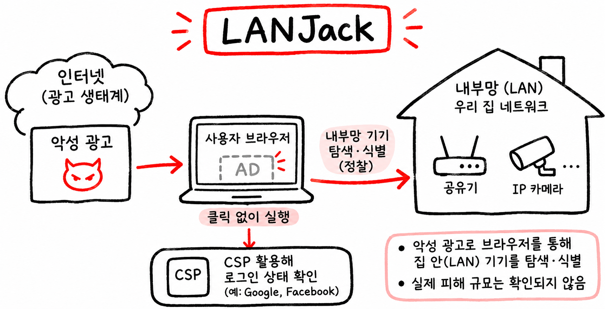

# [Black Hat USA 2026] LANJack 발표 리뷰

<iframe width="560" height="315" src="https://www.youtube-nocookie.com/embed/5HpphRnlzxk?si=DLWeZtSAOUvJs04Q" title="YouTube video player" frameborder="0" allow="accelerometer; autoplay; clipboard-write; encrypted-media; gyroscope; picture-in-picture; web-share" referrerpolicy="strict-origin-when-cross-origin" allowfullscreen></iframe>

## 개념 정리
 
 
### 내부망(LAN)
집 와이파이에 연결된 기기들끼리의 네트워크다. 공유기, IP 카메라, 프린터 같은 것들이 `192.168.0.x` 같은 주소를 갖고 있다. 이 주소는 바깥 인터넷에서는 직접 접근이 안 된다. 그래서 다들 "집 안에 있으니까 안전하겠지" 하고 관리자 비밀번호도 기본값 그대로 두는 경우가 많다.
 
### 동일 출처 정책(SOP, Same-Origin Policy)
브라우저의 기본 보안 규칙이다. 쉽게 말하면 **A 사이트에서 돌아가는 코드는 B 사이트 내용을 마음대로 읽을 수 없다**는 것. 이게 없으면 내가 이상한 사이트를 켜놓은 사이에 그 사이트가 내 네이버 메일을 읽어갈 수도 있다.
 
### DNS / DNS Rebinding
DNS는 `google.com` 같은 이름을 실제 주소(IP)로 바꿔주는 인터넷 전화번호부다.
DNS Rebinding은 이 전화번호부를 공격자가 직접 운영하면서 **처음엔 진짜 번호를 알려줬다가, 두 번째 물어볼 때는 우리 집 안 내선번호를 알려주는** 수법이다. 브라우저 입장에선 계속 같은 사이트 이름이랑 통신하는 거라 SOP에 안 걸린다. 결과적으로 외부 사이트 코드가 우리 집 공유기나 카메라랑 대화할 수 있게 된다.
 
### iframe
웹페이지 안에 다른 웹페이지를 끼워 넣는 창이다. 광고도 대부분 iframe으로 뜬다. 크기를 1픽셀로 만들거나 숨기면 사용자는 그런 게 있는지도 모른다.
지금 현재 본문에서 쓰고있는 youtube 영상도 iframe이다!
 
### CSP(Content Security Policy)
"이 페이지에서는 이 사이트들 것만 불러와도 된다"고 정해두는 허용 목록이다. 규칙을 어기면 브라우저가 막고, 설정해둔 주소로 "누가 규칙 어겼다"는 신고(리포트)를 보낸다. 원래는 XSS 같은 공격을 막으려고 만든 방어 기능이다.
 
## 발표 내용 정리
 
### 광고가 왜 공격 통로가 되는가
 
예전엔 광고주랑 사이트 운영자(게시자)가 직접 계약해서 무슨 광고가 뜨는지 서로 다 알았다. 지금은 중간에 광고 중개 업체가 여러 단계 끼어서 자동으로 경매하듯 광고가 붙는다. 그래서 사이트 운영자도 자기 사이트에 지금 무슨 광고가 떠 있는지 모른다.
 
게다가 요즘 광고는 그냥 그림이 아니라 브라우저 안에서 실행되는 프로그램(JavaScript)이다. 중개 업체를 거칠 때마다 각자 코드를 한 조각씩 붙인다. 사이트가 CSP나 sandbox로 광고를 가두면 되긴 하는데, 그러면 광고가 제대로 안 돌아가서 수익이 줄어든다. 그래서 잘 안 건다고 한다.
 
발표자 말을 빌리면 광고 생태계 자체가 **믿을 만한 사이트 안에서 모르는 사람 코드를 하루 수십억 번 실행해주는 플랫폼**이 돼버린 셈이다. 나는 악성 광고를 "이상한 거 클릭하면 당하는 것" 정도로만 생각했는데, 이 발표는 클릭이 필요 없는 공격이다.
 
### 발견 과정
 
발표자는 원래 auto-redirect 광고(광고가 뜨자마자 사용자를 다른 사이트로 튕겨내는 것)를 찾고 있었다고 한다. 그러다 이상한 광고 하나를 발견했다.
 
- 요즘 다 HTTPS 쓰는데 굳이 HTTP로 통신하고
- 불러오는 파일 이름이 `performance metric`, `IP scanner`
그런데 정작 광고 내용은 코카콜라 캠페인이었음. 트래픽을 따라가 보니 우리 집 내부망 주소로 가는 요청이 수천 개였고, `cam scanner`(카메라 스캐너)라는 파일을 받아서 결과를 외부 서버로 보내고 있었다. 광고가 노린 지역은 멕시코였고, 몇 년째 버전을 바꿔가며 운영되고 있었다고 한다.
 
### 공격 흐름 (5단계)

 
#### 1. 숨기 + 실행 경로 확보
 
공격자는 보안 업체 스캐너한테는 정상 광고만 보여주고 **진짜 타겟한테만 악성 코드를 내려준다**(클로킹). 그리고 공격 코드를 숨겨진 iframe으로 실행하는데, 이게 막히는 환경이면 페이지 자체를 강제로 이동시키는 방법을 대신 쓴다. 하나 막혀도 다른 걸로 가겠다는 거다.
 
#### 2. 미리 준비해두기 (캐시 프라이밍)
 
DNS Rebinding의 천적은 **캐시**다. 브라우저나 공유기가 "아까 물어본 주소 기억해뒀어" 하고 전화번호부를 다시 안 보면 내선번호로 바꿔치기를 못 한다(DNS pinning).
 
그래서 공격자는 카메라나 공유기가 주로 쓰는 포트마다 서로 다른 서브도메인 수백 개를 만들어두고, 공격 코드를 미리 받아서 캐시에 저장해둔다. 나중에 필요한 것만 꺼내 쓰려는 것.
 
#### 3. 우리 집 기기 찾기 (내부망 스캔)
 
여기가 제일 인상 깊었다.
 
Chrome이랑 Firefox에는 **Local Network Access**라는 기능이 있다. 웹사이트가 내 내부망 기기에 접근하려고 하면 "허용할까요?" 하고 물어보는 기능이다. 근데 발표에 따르면 **허락을 물어보기 전에 연결 시도가 먼저 나간다.** 그래서 사용자가 "차단"을 눌러도 응답이 얼마나 빨리 왔는지는 잴 수 있다.
 
이걸로 공격자는 이렇게 한다.
 
- 흔한 공유기 주소들(`192.168.0.1`, `192.168.1.1` 등)에 요청을 보내고 바로 끊는다
- 제일 빨리 반응한 게 우리 집 공유기다
- 그 공유기 주소 대역 전체를 같은 방식으로 훑는다
- 대답이 오면 기기가 있는 것, 시간 초과면 없는 것
재밌는 건 "404 Not Found" 에러도 **"여기 뭔가 있다"는 증거**가 된다는 점이다. 에러를 돌려줄 기기가 거기 있다는 뜻이니까.
 
#### 4. 어떤 기기인지 알아내기
 
기기를 찾으면 이제 DNS Rebinding으로 그 기기랑 직접 대화한다. 그 다음엔 기기 관리 페이지의 **파비콘**(브라우저 탭에 뜨는 작은 아이콘)을 가져와서 해시(지문 같은 고유값)를 뜬다. 제조사마다 아이콘이 다르니까 이걸로 "아 이건 Hikvision 카메라구나" 하고 알아낸다. Shodan 같은 검색엔진도 같은 방식을 쓴다.
 
모델을 알면 그 모델에 맞는 요청을 보내 정보를 가져간다. 대상은 Hikvision, Dahua, UniView 카메라랑 TP-Link, Linksys 공유기 등이었다. 그중에는 **카메라 비밀번호를 초기화하는 옛날 취약점** 요청도 있었다고 한다.
 
#### 5. 흔적 지우기
 
없는 이미지를 수천 번 요청해서 페이지와 네트워크 기록을 쓰레기로 덮어버리는 코드도 들어 있었다. 다만 실제로 실행된 건 확인 못 했다고 한다.
 
### 변종: 방어 기능으로 로그인 여부 알아내기
 
개인적으로 이게 제일 재밌었다. 이 버전은 코드가 거의 없다. 숨겨진 창 안에서 **Google 내 활동 페이지**랑 **Facebook 가족 센터**를 불러오기만 한다.
 
트릭은 CSP다. 공격자는 일부러 허용 목록을 좁게 설정하고, 규칙 위반 신고가 자기 서버로 오게 해둔다.
 
- **Google에 로그인돼 있으면** → 내 활동 페이지로 이동 → 허용 목록에 없음 → 신고가 공격자에게 감 → "이 사람 구글 로그인 상태구나"
- **Facebook에 로그인 안 돼 있으면** → 로그인 페이지로 이동 → 허용 목록에 없음 → 신고가 감 → "이 사람 페북 로그인 안 했구나"
즉 **신고가 왔냐 안 왔냐만으로 로그인 상태를 알아내는 것**이다. 공격을 막으려고 만든 CSP를 반대로 정보 빼내는 데 쓴 거라서, 이런 발상은 생각도 못 해봤다.
 
## 느낀 점
 
전체적으로 보면 본 공격 전의 **정찰 단계**였다. 도둑으로 치면 아직 집에 들어오진 않았고 동네를 돌면서 어느 집에 무슨 CCTV가 있고 어느 집 문이 허술한지 적어가는 단계다. 발표자도 실제로 뭘 얼마나 털어갔는지는 모른다고 했다.
 
무서운 건 어디 하나가 크게 뚫린 게 아니라는 점이다. 광고에 대한 신뢰, 브라우저 동작 순서, CSP 같은 방어 기능을 하나씩 조합해서 만든 공격이다. 그래서 각각만 보면 별거 아닌 것처럼 보인다.
 
공부하면서 SOP나 CSP를 "이렇게 막아준다" 위주로만 외웠는데, 이번 발표 보고 나서는 "이게 어디서 새는지"를 같이 봐야겠다는 생각이 들었다.
 
발표자가 마지막에 꼭 기억하라고 한 세 가지
 
1. 악성 광고는 클릭 안 해도 브라우저를 통해 공격할 수 있다
2. 브라우저가 접근할 수 있으면 공격자도 접근할 수 있다고 봐야 한다
3. 집 안 기기라도 암호화 통신이랑 비밀번호(인증)는 꼭 걸어야 한다