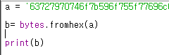
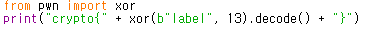

# CryptoHack_CTF
> https://cryptohack.org/

현재 위 사이트의 ctf writeup을 정리하여 놓았습니다

## Find_flag

단순히 flag를 연습하는방법을 제시함. 본문에 Flag제시.

> crypto{y0ur_f1rst_fl4g}

## Great Snakes

첨부파일로 나온 python 파일을 실행하여 보면 해당 플래그를 얻을수 있었다.

> crypto{z3n_0f_pyth0n}

## ASCII

제시해준 정수 배열을 하나하나 ASCII 코드와 대조하여 치환한다.

해당문제는 python3에서 구동하였다.

_chr()_ 함수를 사용하면 ASCII 번호를 문자로 치환이 가능하다.

> crypto{ASCII_pr1nt4bl3}

## HEX

본 문제는 16진수 문자열로 인코딩된 문제가 보인다.

본문에서 제공한대로 바이트로 디코딩후 플레그 제시.

(본문)
> 63727970746f7b596f755f77696c6c5f62655f776f726b696e675f776974685f6865785f737472696e67735f615f6c6f747d

16진수로 인코딩된 문제를 python에서 bytes.fromhex()를 통해 byte로 변환이 가능합니다.

> crypto{You_will_be_working_with_hex_strings_a_lot}

## Base64

해당 16진수 문자열을 byte로 만든후 base64로 인코딩후 ASCII 문자열로 제시하라고 함.

> 72bca9b68fc16ac7beeb8f849dca1d8a783e8acf9679bf9269f7bf

Base64를 임포트해 **base64.b64encode()**를 사용하였다.

> crypto/Base+64+Encoding+is+Web+Safe/

## Bytes and Big Integers

pip 으로 pycryptodome을 설치한후

> crypto{3nc0d1n6_4ll_7h3_w4y_d0wn}

## XOR Starter

XOR 논리연산자는 두 비트가 같으면 0 아니면 1을 반환합니다.

label ^ 13 의 연산을 문제에서 crypto{new_string}양식에 맞게 작성하여준다.

앞서 label string을 이진수로 변환후 13과 함께 변환을 해준다.

필자는 pwn 라이브러리를 통해 작성하였다.

label string을 byte로 만든후 13과 xor 연산을 하여 출력한다

> crypto{aloha}

## XOR Properties

임의 키와 플래그를 xor 연산한 값을 제시하여줍니다.  
이를통해 마지막줄의 암호화를 해제하면 플래그가 제시됩니다.

(본문)

KEY1 = a6c8b6733c9b22de7bc0253266a3867df55acde8635e19c73313  
KEY2 ^ KEY1 = 37dcb292030faa90d07eec17e3b1c6d8daf94c35d4c9191a5e1e 
KEY2 ^ KEY3 = c1545756687e7573db23aa1c3452a098b71a7fbf0fddddde5fc1 
FLAG ^ KEY1 ^ KEY3 ^ KEY2 = 04ee9855208a2cd59091d04767ae47963170d1660df7f56f5faf

먼저 16진수 값을 byte로 decoe하여 K1의 값을 구한다.

이후 xor 특성에 근거하여 (동일값끼리 만나면 0이 된다)

**(FLAG ^ KEY1 ^ KEY3 ^ KEY2) ^ KEY1 ^ (KEY2 ^ KEY3)** 을 통해 
FLAG를 구할수 있다.

>crypto{x0r_i5_ass0c1at1v3}
