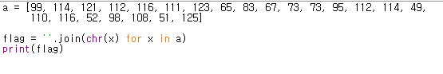
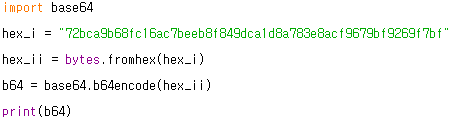
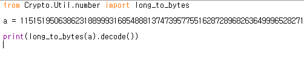

## Find_flag

단순히 flag를 연습하는방법을 제시함. 본문에 Flag제시.

> crypto{y0ur_f1rst_fl4g}

## Great Snakes

첨부파일로 나온 python 파일을 실행하여 보면 해당 플래그를 얻을수 있었다.

> crypto{z3n_0f_pyth0n}

## ASCII

제시해준 정수 배열을 하나하나 ASCII 코드와 대조하여 치환한다.

해당문제는 python3에서 구동하였다.

_chr()_ 함수를 사용하면 ASCII 번호를 문자로 치환이 가능하다.

> crypto{ASCII_pr1nt4bl3}

## HEX

본 문제는 16진수 문자열로 인코딩된 문제가 보인다.

본문에서 제공한대로 바이트로 디코딩후 플레그 제시.

> 63727970746f7b596f755f77696c6c5f62655f776f726b696e675f776974685f6865785f737472696e67735f615f6c6f747d

16진수로 인코딩된 문제를 python에서 bytes.fromhex()를 통해 byte로 변환이 가능합니다.

> crypto{You_will_be_working_with_hex_strings_a_lot}

## Base64

해당 16진수 문자열을 byte로 만든후 base64로 인코딩후 ASCII 문자열로 제시하라고 함.

> 72bca9b68fc16ac7beeb8f849dca1d8a783e8acf9679bf9269f7bf

Base64를 임포트해 *base64.b64encode()*를 사용하였다.

> crypto/Base+64+Encoding+is+Web+Safe/

## Bytes and Big Integers

pip 으로 pycryptodome을 설치한후

> crypto{3nc0d1n6_4ll_7h3_w4y_d0wn}
