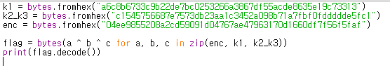
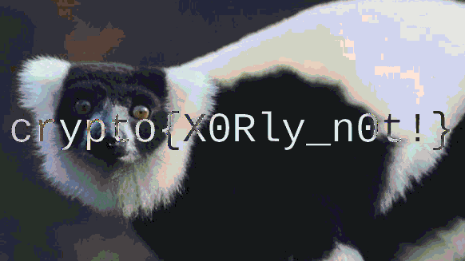

## XOR Properties

임의 키와 플래그를 xor 연산한 값을 제시하여줍니다.<br>
이를통해 마지막줄의 암호화를 해제하면 플래그가 제시됩니다.

```본문
KEY1 = a6c8b6733c9b22de7bc0253266a3867df55acde8635e19c73313 <br>
KEY2 ^ KEY1 = 37dcb292030faa90d07eec17e3b1c6d8daf94c35d4c9191a5e1e<br>
KEY2 ^ KEY3 = c1545756687e7573db23aa1c3452a098b71a7fbf0fddddde5fc1<br>
FLAG ^ KEY1 ^ KEY3 ^ KEY2 = 04ee9855208a2cd59091d04767ae47963170d1660df7f56f5faf
```

먼저 16진수 값을 byte로 decoe하여 `K1`의 값을 구한다.

이후 xor 특성에 근거하여 (동일값끼리 만나면 0이 된다)

**(FLAG ^ KEY1 ^ KEY3 ^ KEY2) ^ KEY1 ^ (KEY2 ^ KEY3)** 을 통해<br>
FLAG를 구할수 있다.



> crypto{x0r_i5_ass0c1at1v3}

## Favourite byte

XOR 연산을 이용해 1바이트 데이터를 숨겨놓았다는 문자열을 보여줍니다.

> 73626960647f6b206821204f21254f7d694f7624662065622127234f726927756d

해당 문자열을 먼저 16진수에서 디코딩화를 한다음 xor연산을 통해 flag을 찾아야합니다.

```python
x = bytes.fromhex("73626960647f6b206821204f21254f7d694f7624662065622127234f726927756d")

for key in range(256):

    result = []

    for b in x:
        result.append(b ^ key)

    result = bytes(result)

    if b"crypto" in result:
        print(result)
```

1바이트 데이터를 숨겨놓았으므로 임의의 키값을 디코딩한 값 x에 무차별 대입(y)을 해줍니다.

Flag형식이 `crypto{""}` 의 형태이므로

만약 생성된 문자열이 "crypto"를 포함할경우 출력하는 형태를 만들어줍니다.

> crypto{0x10_15_my_f4v0ur173_by7e}

## You either know, XOR you don't

해당 문제는 암호화된 문자열을 주고 이를 복호화하여야 합니다.

```
0e0b213f26041e480b26217f27342e175d0e070a3c5b103e2526217f27342e175d0e077e263451150104
```

힌트에서는 flag의 형식을 기억하라고 하였으므로 해당 암호문에 flag의 시작 부분인 `crypto{`를 XOR 연산하여 봅니다.

XOR 연산은 암호문과 평문을 알고 있다면 역으로 Key값을 구할 수 있다는 특징이 있습니다.

```python
x = bytes.fromhex("0e0b213f26041e480b26217f27342e175d0e070a3c5b103e2526217f27342e175d0e077e263451150104")

print(x)

c = bytes(a ^ b for a, b in zip(b"crypto{", x))

print(c)
```

해당 문자열을 대입하여 보니 다음과 같은 결과가 나옵니다.

```
b'myXORke'
```

해당 결과를 통해 Key값의 시작 부분이 `myXORke`라는 것을 알 수 있으며, 문자열의 형태로 보아 전체 Key값이 `myXORkey`일 것이라 추측할 수 있습니다.

이제 추측한 Key값을 암호문에 XOR 연산하여 복호화를 진행합니다.

```python
key = b"myXORkey"

result = []

for i in range(len(x)):
    result.append(x[i] ^ key[i % len(key)])

result = bytes(result)

print(result.decode())
```

암호문의 길이가 Key값의 길이보다 길기 때문에 나머지 연산자(%)를 사용하여 Key값이 반복적으로 사용되도록 하였습니다.

해당 코드를 실행하면 다음과 같은 flag를 얻을 수 있습니다.

> crypto{1f_y0u_Kn0w_En0uGH_y0u_Kn0w_1t_4ll}

## Lemur XOR

이미지 2장을 제시해주고 Flag를 찾는 문제입니다.
먼저 두 이미 RGB의 byte를 xor연산을 해보겠습니다.

```
from PIL import Image

img1 = Image.open("lemur.png").convert("RGB")
img2 = Image.open("flag.png").convert("RGB")

b1 = img1.tobytes()   
b2 = img2.tobytes()

xored = bytes(a ^ b for a, b in zip(b1, b2))

result = Image.frombytes("RGB", img1.size, xored)
result.save("result.png")
result.show()
```

두 이미지를 이렇게 xor 연산을 해보면


해당 이미지가 나옴을 알수 있습니다.

> crypto{X0Rly_n0t!}

## Greatest Common Divisor

gcd(a,b)를 구하는 알고리즘을 구현하는 문제입니다.

이번문제의 FLAG는 `gcd(66528,52920)`의 값을 구하면 됩니다.

```
def gcd_rec(a: int, b: int) -> int:
    return abs(a) if b == 0 else gcd_rec(b, a % b)
```
재귀함수를 이용해 유클리드 알고리즘을 구현하였습니다.

이제 해당값을 대입하면 

> 1512

## Extended GCD
 
확장 유클리드 알고리즘을 이용하여 a·u + b·v = gcd(a,b) 를 만족하는 정수 u, v를 구하는 문제이다.
 
`p⋅u+q⋅v=gcd(p,q)`의 응용버전으로 
 
> p = 26513, q = 32321 일때 p·u + q·v = gcd(p,q) 를 만족하는 u, v중 작은값을 플래그로 제출
 
p, q 둘다 소수이므로 gcd(p,q)는 1이 나온다.
 
유클리드 호제법은 gcd(a,b) = gcd(b, a mod b) 를 b가 0이 될때까지 반복하는 방식인데,
 
확장 유클리드는 여기서 거꾸로 올라오면서 계수 u, v를 같이 계산해준다.
 
a mod b = a - (a//b)·b 이므로 아래 단계에서 구한 x, y를 이용하면 위 단계의 계수는 (y, x - (a//b)·y) 가 된다.
 
해당문제는 python3에서 재귀함수로 작성하였다.
 
```
def egcd(a, b):
    if b == 0:
        return a, 1, 0
    g, x, y = egcd(b, a % b)
    return g, y, x - (a // b) * y

p, q = 26513, 32321
print(egcd(p, q))
```

 
실행 결과 u = 10245, v = -8404 가 나왔고
 
둘 중 작은값인 v를 제출한다.
 
> -8404

## Modular Arithmetic 1


## Modular Arithmetic 2

## Modular Inverting

## Privacy-Enhanced Mail?

## CERTainly not

## SSH Keys

## Transparency
