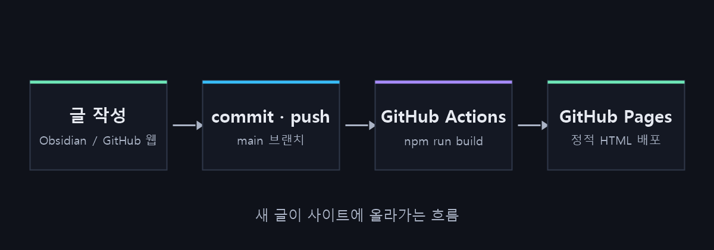

이전 버전의 포트폴리오는 글과 사진을 **브라우저 내부 저장소**에 저장했습니다.
그래서 제 브라우저에서는 글이 보였지만, 링크로 들어온 방문자에게는 아무것도 보이지 않았습니다.

## 바꾼 방식

GitHub Pages는 서버 코드나 데이터베이스를 실행할 수 없기 때문에, 글을 저장소에 파일로 커밋하는 정적 사이트 방식으로 바꿨습니다.



1. `posts/<slug>.md` 에 글을 쓰고, 사진은 `images/<slug>/` 에 넣습니다.
2. `main` 브랜치에 push 합니다.
3. GitHub Actions가 `npm run build` 로 정적 HTML을 만들고 GitHub Pages에 배포합니다.

## 글 파일 형식

글 맨 위에는 frontmatter를 적습니다.

```yaml
---
title: 글 제목
category: ctf
date: 2026-11-07
summary: 목록 카드에 보일 한 줄 요약
cover: ../images/<slug>/cover.png
---
```

> 필수 값이 빠졌거나 이미지 경로가 틀리면 빌드가 실패하고, 어떤 파일의 어떤 문제인지 알려 줍니다.
